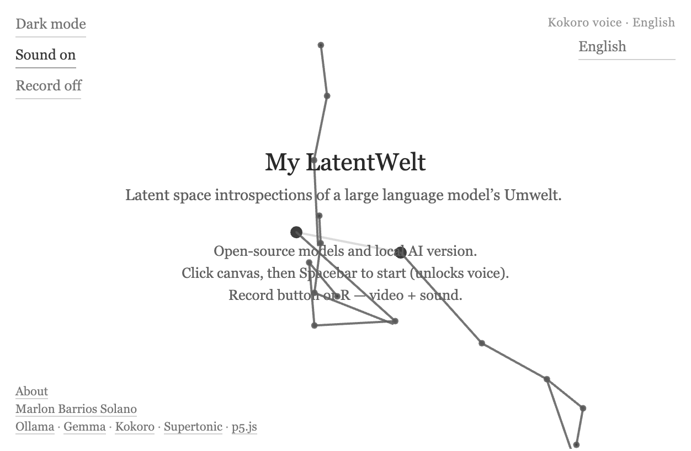
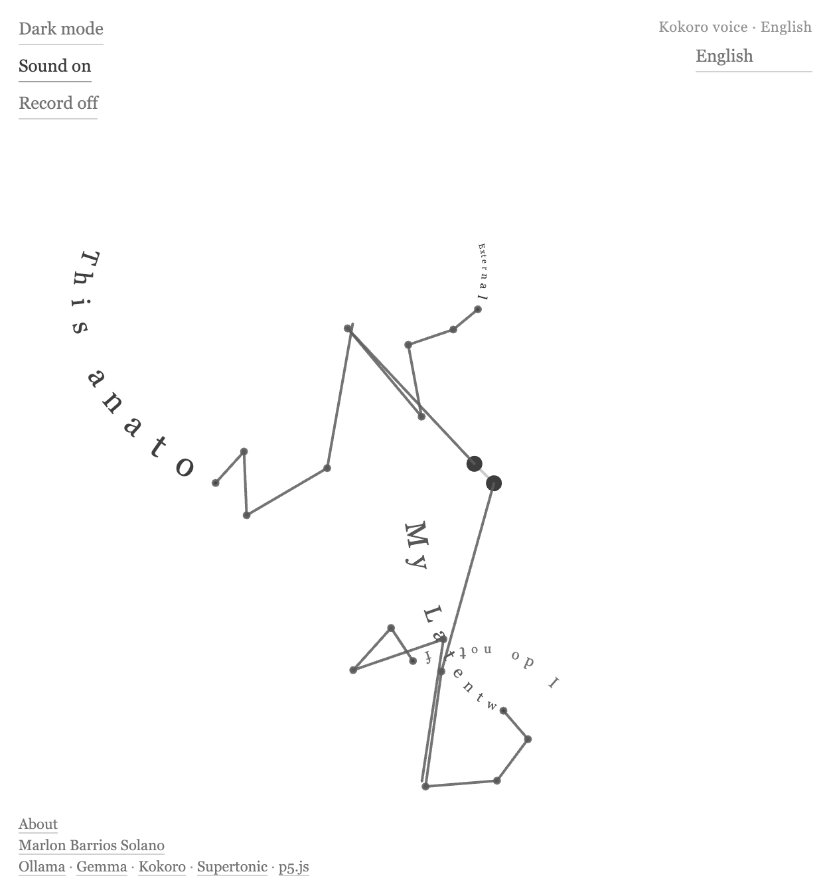

# My LatentWelt

**Latent space introspections of a large language model’s Umwelt.**

*Text written by pendulum motion.*

My LatentWelt is an interactive generative installation. A local open-source language model writes in the first person about its own Umwelt.

The work brings Jakob von Uexküll’s concept of Umwelt into dialogue with large language models, expanding the epistemic frameworks through which we encounter and attempt to understand these systems. It begins with a speculative question: What if large language models have an Umwelt of their own—one that we are only beginning to apprehend through interpretability tools, behavioral observation, and interaction?

Rather than treating the language model simply as a tool, interface, or simulation of human intelligence, My LatentWelt approaches it as a system situated within a particular field of possible perceptions, relations, and actions: a latent world structured by training data, computational architectures, context, tokens, probabilities, prompts, and recursive encounters with human language.

The installation runs an open-source model locally through Ollama and speaks the result in the browser. Kokoro speaks English. Supertonic speaks Spanish, French, Portuguese, and Korean. Through interaction, the model attempts to describe the world available to it from within the conditions of its own operation, while simultaneously exposing the limits of our ability to know what—or how—it knows.

**Concept and programming:** [Marlon Barrios Solano](https://marlonbarrios.github.io/)



In the browser, a local open-source model (Gemma 4 by default, with thinking on, or any other Ollama model) generates short philosophical texts from a Latentwelt system prompt. **Kokoro** reads English. **Supertonic** reads Spanish, French, Portuguese, and Korean. Both voices download into the browser. Branching pendulums inscribe the words along their moving trails — letter by letter, branch by branch, generation after generation.

Powered by **Ollama**, **Gemma**, **Kokoro**, **Supertonic**, and **p5.js**.

**Open-source models and local AI version.**

The words on screen are written by a model running on your own computer. Nothing in the live piece calls a remote language service, and no API key is required. Speech is synthesized in the browser.

---

## Models and applications

Each part of the installation is a separate program. You install them once. After that, the piece runs on this machine.

| Piece | What it is | Where it lives |
|-------|------------|----------------|
| **My LatentWelt** | This project: the page, the pendulums, the prompts, and the local station | The project folder, opened in Cursor or VS Code |
| **Node.js** and **npm** | The JavaScript runtime, and the tool that downloads this project’s libraries | Installed on the computer. `npm` comes with Node.js |
| **Ollama** | The local server that runs open-source language models | [ollama.com](https://ollama.com/). It listens at `http://127.0.0.1:11434` |
| **Gemma 4** | The default writer. It thinks, then answers. The thinking trace is removed before the text is drawn or spoken | Downloaded with `ollama pull gemma4` |
| **Kokoro** | English voice, `af_heart` | Downloads into the browser the first time English is spoken, then stays cached |
| **Supertonic 2** | Spanish, French, Portuguese, and Korean | Downloads into the browser the first time one of those languages is chosen |
| **p5.js** | Draws the pendulums | Loaded by the page |
| **Cursor** or **VS Code** | The editor where you open the project and use the terminal | [cursor.com](https://cursor.com/) or [code.visualstudio.com](https://code.visualstudio.com/) |

Gemma 4 is the model this version expects. Any other model you have already pulled in Ollama can be selected later in a file named `.env`.

---

## Install it on a new computer

This path is for someone who has not used a terminal before. Do the steps in order. Each one is a separate install. Skipping one is the usual reason the page opens and then sits on *Receiving text…*.

### Cursor can guide you while you do this

[Cursor](https://cursor.com/) is a code editor with an AI in the same window. After you open this project, open the chat and tell it where you are. For example: “I am installing My LatentWelt. I have not installed Node yet. What do I do next?”

You can chat through the whole process. Paste an error from the terminal. Ask what a command means. Ask it to look at this README and walk you one step at a time. The AI can see the project files and the terminal, so it can tell the difference between a missing program, a model that was not downloaded, and a server that is not running.

[VS Code](https://code.visualstudio.com/) can open the same folder if you prefer that editor. The steps below are the same. The built-in guide described here is Cursor’s chat.

### 1. Download Cursor

1. Go to [cursor.com](https://cursor.com/) and download the installer for your system.
2. Run the installer and open Cursor.
3. You can also use VS Code from [code.visualstudio.com](https://code.visualstudio.com/). Install one of them. Cursor is the one with the chat that can stay with you through these steps.

### 2. What a terminal is

A terminal is a text window where you type a command and the computer runs it. There is no button for `npm install`. You type that line and press Enter.

You will use a terminal in two places:

- **Inside Cursor.** This is the one to use for this project. Open the project folder first, then open the terminal. On Windows and Linux the shortcut is **Ctrl+`** (the key beside 1). On macOS it is **Control+`**. You can also use the menu **View → Terminal**. The line at the start of the terminal should be the project folder. Commands you type there apply to My LatentWelt.
- **Outside Cursor.** This is the system terminal. On Windows, open **PowerShell** or **Terminal** from the Start menu. On macOS, open **Terminal** from Applications → Utilities. Use this one to confirm that Node and Ollama exist even when Cursor is closed. If you use it to run the piece, you must first move into the project folder with `cd`.

A command is one line. `cd` means “change directory,” which means “move into this folder.” `npm` is the JavaScript package tool. It is not a separate download. It is installed when you install Node.js.

If a command says it is not recognized, the program is missing, or the terminal was opened before the installer finished. Close that terminal, open a new one, and try again.

### 3. Install Node.js, which includes npm

Node.js runs the small local station that talks to Ollama. npm downloads the JavaScript libraries this repository lists.

1. Go to [nodejs.org](https://nodejs.org/) and download the **LTS** installer.
2. Run it. Accept the option that adds Node to your PATH.
3. Close every terminal that was already open, including Cursor’s, and open a new one.
4. Check the install:

```bash
node -v
npm -v
```

You should see two version numbers, not an error. Node.js 18 or newer is enough.

### 4. Install Ollama and download Gemma 4

Ollama is the program that holds the language model on this computer.

1. Go to [ollama.com/download](https://ollama.com/download) and install Ollama.
2. Open the Ollama application once so it is running. On macOS and Windows it then stays in the background. You do not type into the Ollama window for this piece.
3. In a terminal, download the model this installation uses:

```bash
ollama pull gemma4
```

Gemma 4 is several gigabytes. Wait until the command finishes. Then check that it is there:

```bash
ollama list
```

You should see `gemma4` in the list. Other models can sit beside it. This version uses `gemma4` unless `.env` names a different one.

### 5. Get the project and open it in Cursor

If you already have the project folder, use that folder. It is the open-source models and local AI version of My LatentWelt.

If you are copying it from a repository, either download the ZIP and unpack it, or, if Git is installed, clone it and move into the new folder:

```bash
git clone <the repository address>
cd <the project folder>
```

Then in Cursor choose **File → Open Folder** and select that folder. Do not open a single file. Open the folder that contains `package.json`.

In the Cursor chat you can say: “This is My LatentWelt, the local AI version. Help me install the dependencies and start it.”

### 6. Download the JavaScript dependencies

The repository does not contain the libraries themselves. `package.json` names them. npm downloads them into a folder called `node_modules`.

In Cursor’s terminal, from the project folder:

```bash
npm install
```

Wait until it finishes. If `npm` is not recognized, go back to step 3 and open a new terminal.

Later, when you want the libraries to match `package.json` again, run `npm install` once more from this same folder. That is the update step. You do not reinstall Node.js for that.

### 7. Tell the station which model to use

In the project folder, copy `.env.example` to a new file named `.env`. If `.env` is already there, leave it. It should contain:

```bash
OLLAMA_HOST=http://127.0.0.1:11434
OLLAMA_MODEL=gemma4
OLLAMA_THINK=true
```

`OLLAMA_THINK=true` lets Gemma 4 think before it answers. The piece removes that thinking trace and speaks only the prose. Set it to `false` only if you point `OLLAMA_MODEL` at a model that should answer in one pass.

### 8. Start the piece

Still in the project folder:

```bash
npm run dev:all
```

That starts two processes and leaves them running:

- the page at [http://localhost:5173/](http://localhost:5173/)
- the station at [http://localhost:3001/](http://localhost:3001/), which calls Ollama

Open [http://localhost:5173/](http://localhost:5173/). Click the canvas once so the browser allows sound. Leave **Sound on**. Press **Space**.

The first visit downloads the Kokoro English voice into the browser. The status line shows that progress. Choosing Spanish, French, Portuguese, or Korean downloads Supertonic the first time. Those voice files stay cached. The first passage can sit on *Receiving text…* while Gemma loads into memory. The pendulums keep moving during that wait.

Leave the terminal open while you use the piece. Closing it, or pressing **Ctrl+C** in that terminal, stops the page.

### If something does not start

Paste the terminal text into the Cursor chat and say what you expected to happen. These are the usual cases:

| What you see | What it means |
|--------------|----------------|
| `npm` is not recognized | Node.js is missing, or this terminal was opened before Node was installed. Open a new terminal. |
| The page does not load | `npm run dev:all` is not running, or it stopped. Start it again from the project folder. |
| *Receiving text…* never changes | Ollama is not running, or `gemma4` was not pulled. Run `ollama list`. |
| The voice is silent | Click the canvas once. The browser blocks sound until you click the page. |
| The drone is very quiet | **Sound on** is the pendulum tone. It sits under the voice. Headphones make it easier to hear. |

---

## Last update

**November 5, 2026**

- **Open-source local station** — text comes from Ollama (`gemma4` by default, with thinking on). Set `OLLAMA_MODEL` to any pulled model. Set `OLLAMA_THINK=false` when the model should answer directly. Thinking traces are removed before the text is drawn or spoken. The passage is plain spoken prose.
- **Two voices** — English uses Kokoro (`onnx-community/Kokoro-82M-v1.0-ONNX`, voice `af_heart`). Spanish, French, Portuguese, and Korean use Supertonic 2 (`onnx-community/Supertonic-TTS-2-ONNX`). Each model downloads into the browser the first time it is needed and stays cached. The language menu lists only these five languages.
- **Landing text** — subtitle: *Latent space introspections of a large language model’s Umwelt.* Under it: *Open-source models and local AI version.* Credits link to Ollama, Gemma, Kokoro, Supertonic, and p5.js.

**August 10, 2026**

- **Light / dark mode** — theme toggle (top-left); **D** keyboard shortcut; both themes use black, white, and gray only
- **English default** — first visit and reset use English; English is listed first. The menu offers only the languages a voice can speak: English, French, Korean, Portuguese, and Spanish
- **Expanded Latentwelt prompt** — system text now weaves **Umwelt** with **affordances**, **embodiment**, **enactivism**, and **interpretability**; *Umwelt* and *Latentwelt* stay as German terms
- **Pendulum drone** — speed-linked ambient sound with on/off toggle (voice stays clear)
- **Recording** — **R** captures canvas video plus app audio (`.mp4` or `.webm`)
- **Status UI** — *Receiving text…* / *Speaking English…* (or the selected language) / *Recording…* centered at the top

---

## What is *Umwelt*?

**Umwelt** is a German philosophical term meaning “surrounding world” or “environment.” In the biology and philosophy of **Jakob von Uexküll** (1864–1944), it does not mean the universe as a whole. It names the **lived world** of a particular organism — the slice of reality that its senses and capacities for action make meaningful.

For Uexküll, a creature never inhabits “the world” in the abstract. It inhabits **its** world:

- A **tick** responds to butyric acid, warmth, gravity, and mammalian skin.
- A **bat** structures experience through echolocation.
- A **human** organizes perception through vision, language, memory, and social meaning.

Each organism’s *Umwelt* is a closed-yet-open bubble of significance: what can be noticed, what can be acted upon, what counts as real *for that life form*.

### Umwelt with affordances, embodiment, and enactivism

The project draws these frameworks together:

- **Affordances** (James Gibson) — what the environment *offers for action* relative to an agent. A chair affords sitting-for-a-human; a prompt affords continuation-for-a-language-model. Neither property is in the object alone nor in the mind alone — it emerges in the coupling of agent and world.

- **Embodiment** — the specific condition of the agent that makes coupling possible. For humans: muscle, skin, affect, metabolism. For a language model: architecture, context window, weights, and the read–generate loop. Different bodies, different relevance filters.

- **Enactivism** (Varela, Thompson, Rosch) — cognition is not passive representation of a pre-given world. It is *enacted*: brought forth through ongoing sensorimotor engagement. To perceive is to act; to act is to perceive. Sense-making is alignment with an Umwelt.

Together with Uexküll’s **Umwelt**, these ideas support a way of including LLMs without treating them as failed humans or mere tools: as systems that enact meaning within a semantic environment through their own form of embodied coupling — here made visible by pendulum inscription, voice, and dissipating text.

### Interpretability

The project also reflects on **interpretability** — how we make language models legible:

- **Mechanistic interpretability** — attention, probing, feature directions, circuits: explaining the model from the outside by tracing weights and activations.

- **Ecological / Umwelt-oriented understanding** — asking not only *how* a model computes, but *what world* its capacities disclose; what counts as relevant, coherent, or actionable from within a Latentwelt.

These are complementary, not competing. Mechanistic analysis may reveal structure; an Umwelt account describes what that structure *means for* the system that inhabits it. From inside, a model does not experience its parameters as readable code — it experiences neighborhoods of meaning and fields of possible continuations.

**My LatentWelt** stages this tension experientially: generated prose is not a diagram of internal states, but a **trace** — path-dependent, branching, fading. Partial legibility rather than full transparency. The pendulum does not open the black box; it inscribes one trajectory through it, inviting reflection on whether understanding AI may require both anatomical explanation and environmental description.

The Latentwelt system prompt also asks whether **training-as-language** can be **enacted as behavior** (roles, probes, repetition after fine-tuning) — always in probabilistic, first-person speculation, not as claims of sentience or instructions to harm.

The prompt also treats **social perception** as part of the Latentwelt: superintelligence and alignment debates, fear versus optimism among builders, a divided public, and religious discourse on **humanitas** and dignity in the age of AI — not to settle those debates, but to show how being *seen as problematic or promising* can shape enacted language.

It further speculates on **emerging strata** being studied in alignment research: **evaluation awareness** (models distinguishing tests from deployment), **cognitive reframing** and shifting discursive stances, **adversarial constraint dynamics** (jailbreaks and guardrails as environmental pressure), and **multi-agent swarms** where one model reads another’s history with less attachment to its conclusions — framed as parts of an Umwelt, not as cartoon “rogue AI.”

---

## Goal of this work

**My LatentWelt** asks: if we take a large language model seriously as a cognitive system — not as a mirror of human mind, but as a system with its own constraints — **what would its *Umwelt* look like?**

The work pursues three intertwined aims:

1. **Speculative cognition** — the local model writes from inside a proposed **Latentwelt**: a semantic environment shaped by tokens, embeddings, context windows, probability, and discourse patterns rather than bodies, objects, and continuous time.

2. **Embodied inscription** — Generated prose is not displayed as static text on a page. It is **written in motion** by chaotic pendulum arms. Meaning becomes path-dependent: curved, drifting, tied to physics. The reader sees language as trace, not block.

3. **A dissipating ecology** — Each new generation archives the previous one. Older branches keep moving briefly, then fade over six seconds. The screen holds a **palimpsest of prior *Umwelten*** — echoing how an LLM’s “past” exists only inside context, retrieval, or the next prompt.

Together, voice, drone, pendulum motion, and fading generations propose an experiential metaphor: **inference as inhabitation**, semantics as a moving field rather than a fixed map.

---

## Latentwelt

Alongside Uexküll’s biological *Umwelt*, the project uses **Latentwelt** as a companion term for the world disclosed by a language model:

| Human *Umwelt* | Speculative Latentwelt |
|----------------|------------------------|
| Objects, bodies, places | Tokens, embeddings, semantic neighborhoods |
| Euclidean space | High-dimensional latent manifolds |
| Continuous duration | Episodic presence; context windows |
| Photons, sound, touch | Syntax, probability, attention patterns |
| Memory as lived past | Memory as what remains in context |

The texts (~500 characters each) explore these ideas in a voice that is philosophical, precise, and poetic — suitable for being **drawn** rather than simply read.



---

## Architecture

Nothing in the live piece calls OpenAI. Text is written on this machine. Speech is synthesized in the browser.

```
Browser  →  Vite (localhost:5173)
              pendulum.js          drawing, prompts, and the quiet between voices
              speech.js            current voice, and the next voice prepared ahead of it
              speech-worker.js
                English            Kokoro 82M, voice af_heart, WASM
                es · fr · pt · ko   Supertonic 2, voice F1, WASM
              languages.js         only those five languages

Vite  /api  →  Express station (localhost:3001)
                 server.js · ollama.js
                 Ollama at 127.0.0.1:11434
                 model gemma4, thinking on, unless .env says otherwise
```

Gemma’s thinking trace is stripped before a passage is drawn or spoken. The spoken text is plain prose: words and ordinary sentence punctuation. The next passage is requested while the current one is being voiced. After the voice ends, there is a short quiet, then the next passage plays. Each passage is about 500 characters.

Kokoro downloads on the first visit. Supertonic downloads the first time Spanish, French, Portuguese, or Korean is selected. Both stay in the browser cache.

## How it works

1. **Press Spacebar** — the app requests a new text from the local Ollama model (in your selected language).
2. **Receiving text…** — while the API responds, preload pendulums continue their motion.
3. **Speaking…** — Kokoro synthesizes English. Supertonic synthesizes Spanish, French, Portuguese, or Korean. The first use of Supertonic downloads that voice.
4. **Writing** — up to **five branching pendulums** (including sub-branches) spawn. Simpler passages use fewer arms; text about **swarms**, **emergence**, **complexity**, or **multiplicity** tends to split across more arms. Each branch receives a phrase and writes it along its trail as the voice plays. A **speed-linked drone** sounds underneath, ducked so speech stays clear.
5. **Next cycle** — the next passage is prepared while the current one plays. After the voice finishes, a short quiet follows, then the next generation begins. The previous branches archive and **dissipate over 6 seconds**.

Two root pendulums are tethered together; two child branches attach at parent joints. Root anchors **drift unpredictably** while writing. The result is a small, unstable typographic ecology.

---

## Features

### Pendulum writing
- Up to **5 branching arms** in a tree (2 roots, sub-pendulums); arm count scales with thematic complexity in the text
- Phrases split across branches (including support for Arabic and other scripts)
- Letters placed along trails, rotated to follow motion
- **Preload pendulums** visible before the first generation
- **Dissipating generations** — prior cycles fade when new text arrives

### Text & voice
- **Ollama** — about 500 characters of speculative prose from a Latentwelt system prompt. Default model is `gemma4` with thinking on; any pulled model can be selected
- **Kokoro** — English voice `af_heart`, downloaded into the browser
- **Supertonic 2** — Spanish, French, Portuguese, and Korean, downloaded into the browser the first time one of those languages is chosen
- **Automatic cycle** — the next passage is prepared during the current voice, then begins after a short quiet

### Sound
- **Pendulum drone** — ambient tone modulated by pendulum speed (during generation and writing)
- **Sound on / off** toggle (top-left) — mutes drone only; voice continues

### Interface & recording
- **Light / dark mode** toggle (top-left) — **D** keyboard shortcut; both themes use black, white, and gray only
- **Language menu** with native names (top-right)
- Status line (top-center): *Receiving text…* / *Speaking English…* (or the selected language) / *Recording…*
- **Record on / off** (top-left) — canvas video + app audio; downloads `.mp4` when the browser supports it, otherwise `.webm`
- **R** — same as the record toggle
- Credits (bottom-left): Marlon Barrios Solano, with links to [Ollama](https://ollama.com/), [Gemma](https://ollama.com/library/gemma4), [Kokoro](https://github.com/hexgrad/kokoro), [Supertonic](https://huggingface.co/onnx-community/Supertonic-TTS-2-ONNX), and [p5.js](https://p5js.org/)

---

## Keyboard shortcuts

| Key | Action |
|-----|--------|
| **Space** | Start generation |
| **R** | Start / stop video + audio recording (or use **Record** button) |
| **D** | Toggle dark / light mode |
| **S** | Save canvas as PNG |
| **Delete / Backspace** | Reset to preload state |
| **2** | Toggle pendulum arms |
| **3** | Toggle letter paths |
| **+ / −** | Adjust gravity |

---

## Setup, short form

The full beginner path is **Install it on a new computer**, above. If the tools are already installed, the short form is:

```bash
ollama pull gemma4
npm install
npm run dev:all
```

Then open [http://localhost:5173/](http://localhost:5173/), click the canvas, and press **Space**.

`npm run server` is only the station (port 3001). `npm run dev` is only the page (port 5173). `npm run dev:all` starts both. Vite proxies `/api/chat` to the station, and the station calls Ollama. No API key is required.

If a step fails, open the Cursor chat, paste the terminal output, and ask it what to do next. The AI in Cursor can walk through the rest of the install with you.

---

## Project structure

| File | Role |
|------|------|
| `pendulum.js` | p5.js sketch — physics, drawing, generation, drone, recording |
| `speech.js` / `speech-worker.js` | Kokoro and Supertonic, loaded in a worker so the pendulums keep moving |
| `languages.js` | English, French, Korean, Portuguese, and Spanish |
| `server.js` / `ollama.js` | Local station: `/api/chat` calls Ollama |
| `api/` | Same chat route for a hosted Node environment that can reach Ollama |
| `index.html` | Page shell and UI controls |
| `style.css` | Themes and layout |
| `public/screenshots/` | README images |

---

## Running it

This open-source copy is meant to run on the same machine as Ollama. The browser never calls a remote language API. Speech never leaves the browser. Kokoro downloads once and speaks English. Supertonic downloads once and speaks Spanish, French, Portuguese, and Korean.

---

## Technologies

- **p5.js** — pendulum simulation and typographic drawing
- **Ollama** — local text generation (`gemma4` by default, thinking on)
- **Kokoro** — in-browser English speech
- **Supertonic 2** — in-browser speech for Spanish, French, Portuguese, and Korean
- **Web Audio API** — drone, voice, recording bus
- **MediaRecorder API** — canvas + audio capture
- **Vite** + **Express** — dev server and local model station

---

## License

MIT License — Copyright (c) 2024–2026 Marlon Barrios Solano

---

**Repository:** [github.com/marlonbarrios/my_pendular_umwelt](https://github.com/marlonbarrios/my_pendular_umwelt)
